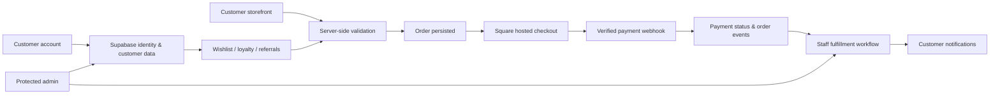

# Port Petals — Ecommerce & Customer Operations Platform

> **Publication status: Approved for public text case study by the Port Petals owner.** This case study is based on the public Cwlwm Systems project README. No customer records, payment data, secrets, unapproved images or internal infrastructure identifiers are included.

## Project at a glance

| | |
| --- | --- |
| **Client** | Port Petals |
| **Industry** | Local floral, gifts, apparel and events retail |
| **Delivery partner** | Cwlwm Systems |
| **Engagement** | Branded ecommerce website and integrated customer/operations application |
| **Documented status** | Production; active development |
| **Live website** | [portpetals.com](https://www.portpetals.com) |
| **Source documentation** | [Cwlwm Systems / port-petals](https://github.com/cwlwmsystems/port-petals) |
| **Project dates** | Not independently established from available documentation |

## Business problem

Port Petals needed an online storefront that supported more than a public product catalog. A retail order affects payment, fulfillment, customer communications, product availability and the staff's operational workload. Customer accounts, marketing consent, loyalty rewards and event inquiries also need to coexist without creating disconnected customer records or requiring every shopper to register.

The project therefore addressed a connected set of needs: branded discovery and ordering, a dependable payment handoff, internal order visibility, customer self-service, rewards and an administrative workflow that staff could manage day to day.

## Solution delivered

Cwlwm Systems built and maintains a Next.js-based ecommerce and operations platform with two main experiences:

**Customer-facing:** A responsive storefront for flowers, gifts, apparel and seasonal merchandise; product and variant selection; cart; local pickup or approved delivery; optional account registration; order history; wishlists; rewards, referrals and birthday benefits. Guest checkout remains available.

**Staff-facing:** Protected administration for products, orders, customers, marketing contacts and consent, campaign workflows, wedding/event inquiries and operational visibility. Customer account information and CRM records are represented separately where their roles differ.

### Core delivered workflows

1. **Browse and order:** Customers select products and a fulfillment method. The application validates product availability, pricing, variants, delivery rules and order totals server-side.
2. **Pay:** The application creates an order and sends customers to Square-hosted checkout. Square payment events, not the customer's browser return, authorize payment-completed status.
3. **Fulfill:** Staff can review orders and operational statuses through the protected admin interface. Order events help track the payment and fulfillment lifecycle.
4. **Return and engage:** Registered customers can review orders, use a wishlist and access their Petals rewards and referral functionality. Guest purchasing and marketing subscription consent remain separate from account creation.

## Technical architecture

| Layer | Documented implementation |
| --- | --- |
| Application | Next.js / React / TypeScript |
| Data, identity and storage | Supabase |
| Payments | Square hosted checkout and verified payment webhooks |
| Transactional messages | Resend |
| Deployment | Vercel |
| Customer experience | Ecommerce, optional accounts, wishlists, rewards and local fulfillment |
| Staff experience | Protected administrative workflows for orders, products, customers and campaigns |

*This is a public-safe conceptual diagram, not a deployment map or complete security architecture.*

## Engineering contribution

Cwlwm Systems documents responsibility for application implementation, ongoing technical maintenance and the integration of storefront, account, order, loyalty, marketing and staff processes. Relevant engineering patterns include:

- Authoritative server-side order and total validation before checkout.
- Square webhook verification and idempotent payment-related operations.
- A ledger-based Petals loyalty model with reward reservation, finalization and cancellation behavior.
- Supabase-backed customer authentication and permission-controlled access to account information.
- Separation between registered customer identity, order history, CRM classification and explicit marketing consent.
- Database-centric order events and differentiated payment versus operational statuses.
- Production deployment, documentation and validation processes.

## Reliability, security and consent

The documented design intentionally keeps sensitive operations on trusted server/database boundaries. In particular, a browser redirect from Square is not treated as proof of payment, account signup does not grant marketing permission, and customer-facing access is restricted to the applicable account data. The README describes webhook validation, Row Level Security, administrative authorization and release verification procedures.

These are documented implementation controls, not an independent security audit or a guarantee that the system is free of vulnerabilities.

## What is in production vs. what is next

**Documented as delivered:** Public ecommerce storefront, Square checkout and payment confirmation, order administration, customer accounts and wishlists, Petals loyalty/rewards, referrals, birthday benefits, customer/CRM visibility, marketing consent and selected campaign administration, event inquiries and notifications.

**Still in development or deferred:** More complete audited admin loyalty adjustments, refined reward expiration presentation, partial-refund loyalty policy, additional automated coverage, certain Birthday Bloom presentation/stacking features and broader reporting refinements. These are *not* presented here as completed functionality.

## Business outcomes and evidence

| Observable outcome | Evidence / limitation |
| --- | --- |
| Customers can use a branded online storefront and Square payment handoff | Documented production application and checkout workflow; live transaction volume not supplied |
| Staff have an integrated order and customer operations interface | Implemented administration features documented in repository README |
| Customers can optionally maintain accounts, order history and rewards | Implemented account and loyalty workflows documented in repository README |
| Marketing consent is explicitly separate from account signup | Documented data/process behavior |

**Not currently established:** revenue increase, conversion-rate changes, labor hours saved, customer retention lift, order volume or quantified ROI. These should be added only if verified measurements and publication permission become available.

## Visuals and demonstration

Suggested approved visuals: a storefront home/product view, a synthetic checkout/fulfillment journey, a sanitized staff dashboard, and a generic customer rewards view. Do not use real customer, order, payment, loyalty or marketing-contact data in public screenshots.

## Support and next steps

The repository lists Cwlwm Systems as the technical steward and describes the site as actively maintained. Future work should prioritize documented reward/accounting edge cases, automated regression tests for payments and reward behavior, continuing release verification, and practical administration improvements.

## Sources and publication notes

**Source reviewed:** [Port Petals repository README](https://github.com/cwlwmsystems/port-petals), accessed November 26, 2026. This case study summarizes documented implementation; it is not an independent live-site acceptance test.

- [x] Port Petals owner approval to publish the text case study and use the business name (confirmed by Cwlwm Systems)
- [x] Production / active development status documented in repository README; exact project dates not supplied
- [x] Public wording limited to repository-documented features and responsibilities
- [x] No screenshots included
- [x] Live URL, repository URL and technical stewardship taken from project README (not independently live-tested)
- [x] Planned and launched features separated based on repository README
